  <!-- Wide Hero Cyber Banner -->
  
  <!-- Highlights & Status Cyber Frame -->
  

    

  <!-- Interactive Terminal Session -->
  

---

### 📊 GitHub Analytics

  
  

 

  

---

### 🐍 Contribution Activity

  

---

### 📬 Connect With Me

<!-- Replace '#' with your actual links whenever you're ready -->

&nbsp;

&nbsp;

&nbsp;

