  <!-- Wide Hero Cyber Banner -->
  
  <!-- Highlights & Status Cyber Frame -->
  

    

  <!-- Interactive Terminal Session -->
  

---

### 🚀 Featured Projects

| Project | Stack | Description |
| :--- | :--- | :--- |
| [**LabBox**](https://github.com/b1t3zzZ/LabBox) | `TypeScript` `Node.js` `Docker` `Prisma` `WebSockets` `xterm.js` | Self-service portal for isolated learning containers with live web terminal, resource limits (`cgroups`) & auto-TTL cleanup. |
| [**Freelance Income Calculator**](https://github.com/b1t3zzZ/P_Prod-Freelance-Income-Calculator) | `Vue 3` `Vite` `TailwindCSS` `JavaScript` | Reactive web calculator for freelancers & self-employed professionals to compute net income, taxes, and platform fees in real time. |
| [**P_DB_106 — ThanosPizza**](https://github.com/b1t3zzZ/P_DB_106) | `MySQL 8.0` `Docker` `MERISE` `SQL` | Complete relational database architecture (MCD/MLD), referential integrity constraints, data migration & analytical queries. |
| [**P_320_Parking**](https://github.com/b1t3zzZ/P_320_Parking) | `C#` `.NET` `MSTest` `OOP` | Object-oriented parking simulation engine with automated unit testing suite and technical documentation. |
| [**P_BULLE — JS Nexus**](https://github.com/b1t3zzZ/P_BULLE) | `JavaScript (ES6+)` `Async/Promises` `DOM` | Interactive JavaScript exercises & challenges covering asynchronous workflows, promises, and modern web patterns. |
| [**CryptoVue**](https://github.com/b1t3zzZ/CryptoVue) & [**WeatherVue**](https://github.com/b1t3zzZ/WeatherVue) | `Vue 3` `Vite` `REST API` `CSS3` | Reactive Vue.js web applications for real-time cryptocurrency exchange tracking and live weather forecasting. |

---

### 📊 GitHub Analytics

  
  

 

  

---

### 🐍 Contribution Activity

  

---

### 📬 Connect With Me

<!-- Replace '#' with your actual links whenever you're ready -->

&nbsp;

&nbsp;

&nbsp;

